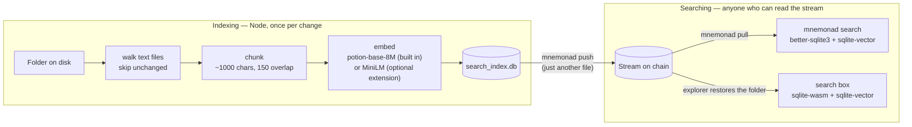
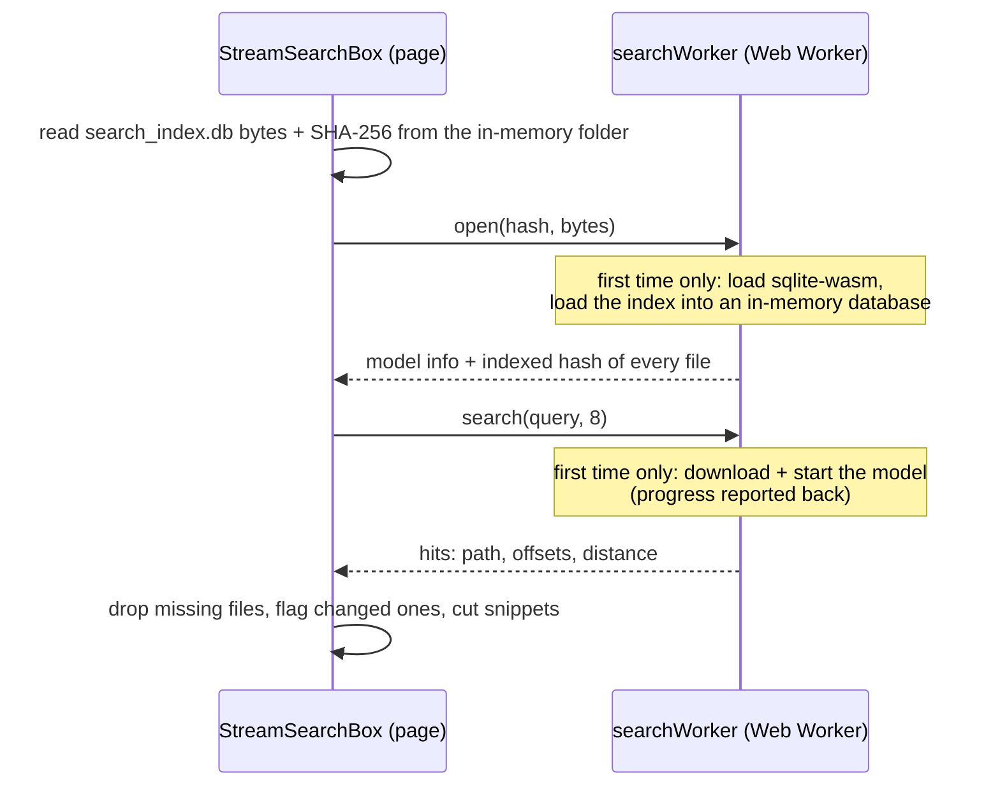

# Vector search

A synced folder can carry its own semantic search index: `search_index.db`, one SQLite file at
the folder root. `mnemonad index` builds it, the next `mnemonad push` uploads it like any other
file, and from then on everyone who can read the stream can search it by meaning. They can do
that from the CLI after a pull, or right in the explorer's file browser. Nobody has to embed
the corpus again: the embeddings are already in the file.

Search is optional throughout. A folder without `search_index.db` has no search, and nothing
else about push/pull/diff/watch changes either way.

Implemented in the CLI's search engine, [`cli/lib/search/`](../cli/lib/search) (indexing, and
both readers), wired into the CLI's commands by
[`cli/lib/commands/buildIndex.js`](../cli/lib/commands/buildIndex.js) and
[`cli/lib/commands/search.js`](../cli/lib/commands/search.js), and into the explorer by
[`explorer/src/mnemonad/StreamSearchBox.vue`](../explorer/src/mnemonad/StreamSearchBox.vue) and
[`explorer/src/mnemonad/search/`](../explorer/src/mnemonad/search).

## The whole flow



Only the right-hand side needs the embedding model on the reader's machine, and only to embed
the query string. Embedding the corpus happens once, on the machine that ran `mnemonad index`.

## 1. Building the index

```bash
mnemonad index ~/my-data
```

`Indexer` (`cli/lib/search/Indexer.js`) walks the folder and, for each file:

1. **Skips what shouldn't be embedded.** The CLI's usual exclusions apply (`node_modules`,
   `.git`, `.env`, `.mnemonad`, lockfiles, …, plus `--exclude`). Dotfiles are skipped too.
   The index file itself is excluded explicitly: parts of a SQLite file look enough like text
   that the binary check alone isn't a safe guard. Everything else goes through a binary
   check: a null byte in the first 8000 bytes marks the file as binary and skips it (the same
   heuristic git uses).
2. **Skips what hasn't changed.** The file's fingerprint (SHA-256 of its bytes, doublesync's
   `getFingerprint()`) is compared with the hash recorded at its last indexing. A match skips
   the file entirely: no chunking and no embedding. This makes re-running `index` after a small
   edit cheap.
3. **Chunks the text.** `TextWindowChunkingStrategy` cuts windows of about 1000 characters
   with 150 characters of overlap. Each window ends at the nearest paragraph break, sentence
   end or space in its second half, rather than mid-word. The chunks are counted in
   characters, not tokens, so chunking needs no tokenizer. 1000 characters is roughly 250
   tokens of English prose, within what small embedding models accept. `--chunk-size` and
   `--chunk-overlap` change the window.
4. **Embeds all changed files in one batch**, with the model the index uses (see "Choosing a
   model" below). Everything runs locally: no API key, and no file content leaves the machine.
   The model downloads once and is cached.

Files that are gone from the folder are dropped from the index at the end of the run.

For scale: the test stream's 291 Aesop's fables became 327 chunks and a 744 KB index (with
MiniLM's 384-dimension vectors; potion's are 256).

### Choosing a model

Two models, one built in and one optional:

| | potion-base-8M (built in, default) | MiniLM (optional extension) |
|---|---|---|
| `--model` | `potion` | `minilm` (full id `Xenova/all-MiniLM-L6-v2`) |
| What it is | Static embeddings (model2vec): a lookup table of one vector per token, averaged | A small neural network (6 layers), run by transformers.js on ONNX Runtime |
| Vectors | 256 dimensions | 384 dimensions |
| Install | Part of mnemonad-cli: pure JS, no native code or WASM | `npm install -g mnemonad-search-transformers`, about 450 MB (mostly ONNX Runtime) |
| Model download | about 31 MB, once | about 23 MB, once |
| Embedding speed | a whole folder in milliseconds (321 fable chunks: 0.12 s) | 60–85× slower here (the same chunks: 10.2 s) |

Measured on this project's own corpora, with 29 queries whose right answer is known (5 keyword
and 10 paraphrased queries over the fables, 5 keyword and 9 question-style queries over these
docs):

| | Right file ranked first | Right file in the top 3 |
|---|---|---|
| Fables | potion 9/15, MiniLM 8/15 | potion 10/15, MiniLM 13/15 |
| Docs | potion 7/14, MiniLM 12/14 | potion 12/14, MiniLM 14/14 |

The two tie on keyword queries. On paraphrases, where the query and the text share meaning but
few words, MiniLM is clearly better, and potion occasionally misses by a long way. A static
model sees which words are there, not their order or context. It's a small set of queries,
written by hand, so read it as a direction rather than a benchmark.

Rules that keep an index consistent:

- **One model per index.** The index records its `model` and `embedder`. Two models' vectors
  can't be compared (they usually aren't even the same length), so re-indexing with a
  different `--model` is refused. `--rebuild` starts the index over with the new model; the
  next push then uploads the whole index again.
- **No `--model` means the index's own model.** Re-indexing a folder someone built with MiniLM
  keeps MiniLM. Only a brand-new index, or `--rebuild` without `--model`, gets potion.
- **`search` always uses the index's own model.** A pulled index built with MiniLM needs the
  extension to be searched from the CLI; without it, `search` says how to install it, or how
  to rebuild the index with potion.

The extension isn't a dependency of mnemonad-cli, so the CLI's install stays small. It's found
at runtime: first with a plain import, which reaches it for a local install, for `npx -p … -p …`,
and for npm's global installs (global packages sit side by side in one `node_modules`); then
through `npm root -g` for other layouts. The two agree on a small interface (`apiVersion`,
`createProvider()`), and the CLI checks the version, so an out-of-date extension gets an
"update both" message instead of failing obscurely.

**MiniLM's precision is pinned to q8.** Left alone, transformers.js loads fp32 weights under
Node and q8 weights in a browser, so an index built by the CLI and queried in the explorer would
embed the corpus with one set of weights and the query with another. The extension asks for q8
on both sides, and the indexer records it as the index's `dtype`. A MiniLM index with no `dtype`
recorded (built before this was added) is read as fp32.

## 2. The index file

Three plain tables, defined in `cli/lib/search/VectorIndex.js`:

| Table | One row per | Holds |
|---|---|---|
| `search_index` | chunk | `path`, `chunk_index`, `content_hash`, `start_offset`, `end_offset`, `embedding` (float32 BLOB) |
| `search_index_files` | file | `path`, the `content_hash` it's currently indexed at, `chunk_count` |
| `search_index_meta` | setting | `model`, `embedder` (`model2vec` or `transformers`), `dimension`, `dtype` (MiniLM only), `chunk_size`, `chunk_overlap` |

Chunk text is not stored, only its offsets into the file. A snippet is always read back from
the file itself, which is right there next to the index after a pull or in the explorer.

### Why it stays cheap to push again

Mnemonad pushes a changed file as a content-defined diff, so what a re-index costs on chain
depends on how much of the file's bytes actually move. The format is built around that:

- **Chunks are only ever inserted, never updated or deleted.** Re-indexing a changed file
  appends its new chunks and updates that file's single row in `search_index_files` to the
  new hash. The old chunks stay in the file physically, but a search only counts a chunk
  whose `content_hash` matches its file's current row (see the join below), so they drop out.
  Appending rows touches only new and near-full pages. A measured run (200 rows, then 5 more)
  cost about 2.9× the new data's raw size on the next push, far from a full rewrite.
- **No `VACUUM` during normal indexing**, because it rewrites every byte. `VectorIndex.compact()`
  is the explicit, rare exception: it deletes the stale chunks and vacuums, at the price of
  one full-size push.
- **No WAL mode.** A write-ahead log would leave a separate `-wal` file holding pages that
  haven't been merged into the main file yet. The index uses SQLite's default journal and
  closes the database after every run, so the file on disk is always complete before a push.
- **Exact search, no ANN index.** Every query is a full scan with sqlite-vector's
  `vector_full_scan`. A partitioned approximate index would reshuffle pages on every insert
  and defeat the diffing. A full scan is fast at the size a synced folder realistically has.

## 3. Sharing it

The file is named `search_index.db`, not `.search_index.db`, on purpose: the CLI skips
dotfiles, and this one must travel. A plain `push` includes it; the `index` command says so
when it has changed something. A `pull` brings it back down with the rest of the folder, so
the pulled copy is searchable immediately.

`push --index` does both steps in one: it updates the index, then pushes. It uses the push's own
`--exclude` for the index, so the index covers exactly the files that get uploaded. If indexing
fails, nothing is pushed, rather than publishing a stream whose index is missing or stale.
`watch --index` re-indexes before every automatic push, with one model load for the whole
session. It records the folder's state *after* indexing, so writing the index file doesn't set
off a second push.

A plain `push` of a folder that has an index checks it before uploading. It compares each file's
hash with the one recorded in the index, without loading the model and with the index opened
read-only. If files changed, it prints a note suggesting `--index`.

For an **encrypted stream** the index is encrypted like every other file in it. Reading it
takes the same key as reading the files. In the explorer, the search box only appears once
the stream has been unlocked.

## 4. Searching from the CLI

```bash
mnemonad search ~/my-data "slow and steady wins the race" -k 3
```

`Searcher` (`cli/lib/search/Searcher.js`):

1. Opens `search_index.db` read-only and reads `model`, `embedder`, `dimension` and `dtype`
   from its metadata.
2. Loads the model that built the index (through the extension, for MiniLM) and embeds the
   query. A query vector whose length doesn't match the index is refused with an error naming
   the recorded model.
3. Runs the search query shared with the browser (below) through better-sqlite3 and the
   native sqlite-vector extension.
4. Prints each hit's path, chunk number and cosine distance, with a snippet cut out of the
   source file at the stored offsets.

### The query

Defined once in [`cli/lib/search/schema.js`](../cli/lib/search/schema.js) and used by both
readers:

```sql
SELECT s.path, s.chunk_index, s.start_offset, s.end_offset, v.distance
FROM vector_full_scan('search_index', 'embedding', :query, :overfetch) v
JOIN search_index s ON s.id = v.rowid
JOIN search_index_files f ON f.path = s.path AND f.content_hash = s.content_hash
ORDER BY v.distance ASC
LIMIT :k
```

- **`vector_full_scan`** ranks every chunk by cosine distance to the query. Distance is
  0 for identical direction and grows as the chunks get less similar.
- **The second join** keeps only chunks indexed at their file's current hash, which is how
  the stale rows from section 2 disappear.
- **Overfetch:** because that join can discard some of the scan's top candidates, the scan
  asks for `max(8k, 64)` of them, so `k` results survive.

## 5. Searching in the explorer

When a stream's file browser has a `search_index.db` at its root, a **Search files** box
appears in the panel header, to the right of **Clone**. The check reruns after every live
poll and every local change, so the box comes and goes with the file. Typing searches after a
400 ms pause, and Enter searches immediately.

Nothing is fetched to make this work, apart from the model on first use. After the explorer
restores a stream, the whole folder, index included, is already in memory.



### What runs where

- **The worker** ([`searchWorker.js`](../explorer/src/mnemonad/search/searchWorker.js)) owns
  the two heavy pieces, so neither loading them nor querying ever blocks the page. Both load
  lazily with dynamic `import()`: a visitor who never searches downloads neither.
  - **The database:** `@sqliteai/sqlite-wasm`, which bundles the same sqlite-vector version
    (1.1.2) the CLI loads natively. The index bytes are loaded into an in-memory, read-only
    database with `sqlite3_deserialize`; OPFS and COOP/COEP headers aren't needed for that.
  - **The model:** `BrowserSearcher` (in `cli/lib/search/browser.js`) builds whichever model
    the index recorded. For potion that's the same pure-JS code the CLI runs, with the model
    files kept in the browser's Cache API. For MiniLM, the worker imports the extension's
    provider, and with it transformers.js and ONNX Runtime's WASM build; only an index built
    with MiniLM ever loads them. The first search reports download progress, which the box
    shows as a percentage of the real download size. MiniLM then adds a few seconds of
    "Starting the search model…" while ONNX Runtime starts. After that the browser has
    everything cached.
- **The index is reopened only when it changes.** The page keys it by its SHA-256, so an
  unchanged index isn't reopened after a live poll. Its bytes are copied to the worker, never
  transferred: transferring would detach the buffer the file browser is still using.
- **The page** ([`StreamSearchBox.vue`](../explorer/src/mnemonad/StreamSearchBox.vue)) matches
  every hit against the live folder:
  - **Missing files:** a hit whose file no longer exists is dropped.
  - **Snippets** are decoded from the file's own bytes at the stored offsets, the same way the
    CLI does it.
  - **Changed files:** a hit whose file has changed since indexing is tagged "changed since it
    was indexed", because its offsets may no longer point at the same text. This is detected
    by comparing each file's current SHA-256 with the hash the index recorded, the same
    fingerprint the indexer used.
  - **Score:** shown as `round((1 − distance) × 100)`%, the cosine similarity as a percentage.
- **Clicking a hit** calls `FileManagerBrowserSync.revealPath()`. That walks the current folder
  tree (after a live poll this is newer than the one first mounted), navigates to the file's
  folder, and opens the file in the text editor with the matched passage selected and scrolled
  into view.
  - The editor adjusts offsets for CRLF line endings, because a textarea reports its text with
    plain LF.
  - It works out the scroll position by measuring the rendered text, so wrapped lines don't
    throw it off.
  - Files that were edited since indexing open without a selection.
- **At phone width** (≤ 480 px) the box becomes an icon button like its header neighbours,
  and results open in a sheet across the top of the screen instead of a dropdown.

### The docs page

The explorer's `/docs` page is the same search on a different stream. These docs are
published as a stream of their own by `scripts/push_docs.js`, index included, and
[`StreamDocs.vue`](../explorer/src/mnemonad/docs/StreamDocs.vue) renders that stream's markdown
as a site. Its search runs through the same worker and matching code (`search/folderSearch.js`).
It differs in two ways:

- **What a hit shows:** the doc's title and the section the passage falls under, instead of a
  file path.
- **Where a hit lands:** a highlighted passage in the rendered page, instead of a text-editor
  selection. Each rendered block records the source lines it came from, so a hit's character
  offsets map to exactly the paragraphs, list items or code blocks they cover.

### Explorer build notes

The explorer deploys on its own (Vercel, root directory `explorer/`), so it doesn't depend on
the CLI or the extension as packages. Instead [`vite.config.js`](../explorer/vite.config.js)
sets up the following:

- `@mnemonad-search` is aliased to `../cli/lib/search/browser.js`, and
  `@mnemonad-search-transformers` to `../mnemonad-search-transformers/index.js`. Their imports
  resolve against the explorer's own `node_modules`, the same arrangement `@mnemonad` and
  `@monadsync` use.
- Workers are built as ES modules, which the dynamic imports require, and they get the same
  resolution plugin.
- `@sqliteai/sqlite-wasm` is excluded from dependency pre-bundling, so it can still find its
  `.wasm` file. The worker also passes that file's URL in explicitly.

`@huggingface/tokenizers`, `@huggingface/transformers` and `@sqliteai/sqlite-wasm` are ordinary
explorer dependencies.

## 6. The two readers agree

The CLI and the explorer run the same SQL on the same sqlite-vector build, with the same model
at the same precision. On the fables test stream (a MiniLM index) both rank "slow and steady
wins the race" with The Hare And The Tortoise first, at distance 0.5023 (shown as 50% in the
explorer). Distances
aren't bit-identical: the native and WASM builds do float32 arithmetic slightly differently,
which shows up around the seventh decimal place, far below anything that could reorder
results. [`cli/test/search/browser.test.js`](../cli/test/search/browser.test.js)
builds an index through the Node path and checks that the WASM reader returns the same hits
in the same order, with distances equal to six decimal places.

## 7. What leaves the machine

- **Indexing:** nothing. The model runs locally and file content is never sent anywhere.
- **Searching:** the query never leaves the machine or the browser.
  - The CLI downloads the model from Hugging Face on first use and caches it
    (`~/.cache/mnemonad/models/` for potion).
  - The explorer downloads the model from Hugging Face on first use, and for a MiniLM index
    also ONNX Runtime's WASM from jsDelivr. The browser caches both.
  - Self-hosting these under `explorer/public/` would remove the third-party requests, at the
    price of a larger deploy. It hasn't been done yet.

## 8. Limits

- **There is always a nearest neighbour.** A search returns the closest chunks even when
  nothing really matches: a nonsense query still gets results scoring 20–30%. There is no
  minimum-similarity cutoff yet.
- **Current state only.** The index describes the folder as it was at the last `index` run,
  not every version ever pushed.
- **Stale until re-indexed.** Files edited after indexing keep their old embeddings until
  someone runs `index` (or `push --index`) again. A plain `push` warns about that, and the
  explorer flags such hits, but `mnemonad search` itself doesn't check.
- **Building needs Node.** The browser can only search. `mnemonad index` is the only way to
  create or update an index.
- **Vectors are stored as full float32.** sqlite-vector's `vector_quantize()` (unrelated to
  MiniLM's q8 weights) could shrink them, but whether it keeps the file diff-friendly
  hasn't been checked.

## Code map

| Piece | File |
|---|---|
| Shared format: table names, search SQL, overfetch, models and embedders | `cli/lib/search/schema.js` |
| Build/update an index; one model per index | `cli/lib/search/Indexer.js` |
| Chunking | `cli/lib/search/chunking/TextWindowChunkingStrategy.js` |
| Built-in model (potion, pure JS) | `cli/lib/search/embeddings/StaticEmbeddingProvider.js`, `modelFiles.node.js`, `modelFiles.browser.js` |
| Choosing a provider; finding the extension | `cli/lib/search/providers.js` |
| MiniLM (the optional extension) | `mnemonad-search-transformers/index.js` |
| Node reader/writer (better-sqlite3 + native sqlite-vector) | `cli/lib/search/VectorIndex.js`, `Searcher.js` |
| Browser reader (sqlite-wasm) | `cli/lib/search/browser/WasmIndexReader.js`, `BrowserSearcher.js` |
| Browser entry point | `cli/lib/search/browser.js` |
| CLI commands (`index`, and `--index`/`--rebuild` for `push`/`watch`) | `cli/lib/commands/buildIndex.js`, `cli/lib/commands/search.js` |
| Explorer worker + client | `explorer/src/mnemonad/search/searchWorker.js`, `StreamSearchClient.js` |
| Explorer search box | `explorer/src/mnemonad/StreamSearchBox.vue` |
| Reveal + highlight | `FileManagerBrowserSync.vue` (`revealPath`), `FileManagerBrowser.vue` (`revealItem`), `menus/FileManagerTextEditor.vue` (`selection`) |
