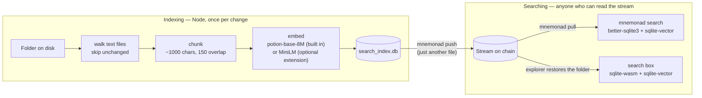
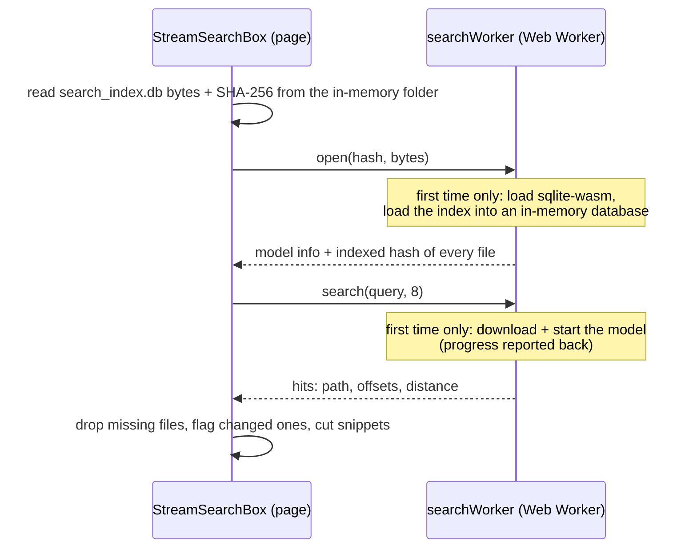

# Vector search

A folder can carry its own search index. The index is one SQLite file, `search_index.db`, at the
root of the folder. It lets users or AI agents search the folder contents by meaning, not only by exact words.

Here is how it works:

1. You run `mnemonad index`. This builds the index.
2. You run `mnemonad push`. This uploads the index like any other file.
3. Anyone who can read the stream can now search it. They can search from the CLI after a
   pull, or in the file browser of the explorer.

Nobody has to embed the files again. The embeddings are already in the file. An embedding is a
list of numbers that represents the meaning of a piece of text. Two pieces of text with a
similar meaning have similar numbers.

Search is optional. A folder without `search_index.db` has no search. Push, pull, diff, and
watch work the same way in both cases.

The search engine is in [`cli/lib/search/`](../cli/lib/search). It does the indexing and has
both readers. Two files connect it to the CLI commands:
[`cli/lib/commands/buildIndex.js`](../cli/lib/commands/buildIndex.js) and
[`cli/lib/commands/search.js`](../cli/lib/commands/search.js). In the explorer,
[`explorer/src/mnemonad/StreamSearchBox.vue`](../explorer/src/mnemonad/StreamSearchBox.vue) and
the folder [`explorer/src/mnemonad/search/`](../explorer/src/mnemonad/search) connect it.

## The whole flow



A reader needs the embedding model only to embed the search query. The files are embedded one
time, on the machine that ran `mnemonad index`.

## 1. Build the index

```bash
mnemonad index ~/my-data
```

`Indexer` (`cli/lib/search/Indexer.js`) goes through the folder. For each file, it does these
steps:

1. **It skips files that should not be embedded.** The usual CLI exclusions apply:
   `node_modules`, `.git`, `.env`, `.mnemonad`, lockfiles, and anything you give with
   `--exclude`. The indexer also skips dotfiles.

   The indexer excludes the index file itself on purpose. Some parts of a SQLite file look
   like text, so the binary check alone is not safe. All other files go through a binary
   check. If a file has a null byte in its first 8000 bytes, the indexer treats it as binary
   and skips it. Git uses the same rule.
2. **It skips files that did not change.** The indexer calculates a fingerprint of the file:
   the SHA-256 of its bytes (`getFingerprint()` of doublesync). It compares the fingerprint
   with the hash from the last indexing. If they match, the indexer skips the file. It does no
   chunking and no embedding. For this reason, a re-run after a small edit is cheap.
3. **It cuts the text into chunks.** In this page, a "chunk" is a piece of text for search.
   It is not the on-chain storage unit. See [Terms](terms.md).

   `TextWindowChunkingStrategy` cuts windows of about 1000 characters. Each window overlaps
   the window before it by 150 characters. A window ends at the nearest paragraph break,
   sentence end, or space in its second half. It does not end in the middle of a word.

   The strategy counts characters, not tokens, so it does not need a tokenizer. 1000
   characters is about 250 tokens of English text. Small embedding models can accept this
   size. Use `--chunk-size` and `--chunk-overlap` to change the window.
4. **It embeds all changed files in one batch.** The indexer uses the model of the index (see
   "Choose a model" below). All work is local. You do not need an API key, and no file content
   leaves the machine. The model downloads one time. The CLI keeps it in a cache.

At the end of the run, the indexer removes the files that you deleted from the folder.

Example size: the test stream has 291 fables from Aesop. They became 327 chunks and an index of
744 KB. This index used MiniLM, which makes vectors of 384 dimensions. Potion makes vectors of
256 dimensions.

### Choose a model

You can choose between two models. One is built in. The other is an optional extension.

| | potion-base-8M (built in, default) | MiniLM (optional extension) |
|---|---|---|
| `--model` | `potion` | `minilm` (full id `Xenova/all-MiniLM-L6-v2`) |
| What it is | Static embeddings (model2vec). The model is a lookup table with one vector for each token. It averages the vectors. | A small neural network with 6 layers. transformers.js runs it on ONNX Runtime. |
| Vectors | 256 dimensions | 384 dimensions |
| Install | Part of mnemonad-cli. It is pure JavaScript, with no native code and no WASM. | `npm install -g mnemonad-search-transformers`. About 450 MB, mostly ONNX Runtime. |
| Model download | About 31 MB, one time | About 23 MB, one time |
| Embedding speed | A whole folder in milliseconds (321 fable chunks: 0.12 s) | 60 to 85 times slower in this test (same chunks: 10.2 s) |

We measured both models on the corpora of this project. We used 29 queries with a known right
answer. There were 5 keyword queries and 10 paraphrased queries about the fables. There were 5
keyword queries and 9 question-style queries about these docs.

| | Right file ranked first | Right file in the top 3 |
|---|---|---|
| Fables | potion 9/15, MiniLM 8/15 | potion 10/15, MiniLM 13/15 |
| Docs | potion 7/14, MiniLM 12/14 | potion 12/14, MiniLM 14/14 |

The two models score the same on keyword queries. On paraphrased queries, MiniLM is clearly
better. A paraphrase has the same meaning as the text, but few of the same words. Potion
sometimes misses by a large margin. A static model sees which words are present. It does not
see their order or their context. The query set is small, and we wrote it by hand. Treat the
results as a direction, not as a benchmark.

Three rules keep an index consistent:

- **One model for each index.** The index records its `model` and `embedder`. You cannot
  compare the vectors of two models. They often have different lengths. For this reason,
  `index` refuses to re-index with a different `--model`. To change the model, use
  `--rebuild`. This starts the index again with the new model. The next push uploads the
  complete index again.
- **No `--model` means the model of the index.** If someone built the index with MiniLM, a
  re-index keeps MiniLM. Only a new index, or `--rebuild` without `--model`, uses potion.
- **`search` always uses the model of the index.** To search an index that was built with
  MiniLM, the CLI needs the extension. Without it, `search` tells you how to install it, or
  how to rebuild the index with potion.

The extension is not a dependency of mnemonad-cli. This keeps the CLI install small. The CLI
finds the extension when it runs. First, it tries a plain import. This works for a local
install, for `npx -p … -p …`, and for npm global installs. Global packages are side by side in
one `node_modules`. If this fails, the CLI uses `npm root -g` for other layouts.

The CLI and the extension agree on a small interface (`apiVersion` and `createProvider()`).
The CLI checks the version. If the extension is old, the CLI shows an "update both" message. It
does not fail with an unclear error.

**MiniLM uses q8 precision on all sides.** By default, transformers.js loads fp32 weights in
Node and q8 weights in a browser. Then the CLI would embed the files with one set of weights,
and the explorer would embed the query with a different set. The results would not match. The
extension asks for q8 in both places. The indexer records this as the `dtype` of the index. If
a MiniLM index has no `dtype`, it was built before this rule existed. The readers treat it as
fp32.

## 2. The index file

The index has three plain tables. `cli/lib/search/VectorIndex.js` defines them.

| Table | One row for each | Holds |
|---|---|---|
| `search_index` | chunk | `path`, `chunk_index`, `content_hash`, `start_offset`, `end_offset`, `embedding` (float32 BLOB) |
| `search_index_files` | file | `path`, the `content_hash` of the file at the last indexing, `chunk_count` |
| `search_index_meta` | setting | `model`, `embedder` (`model2vec` or `transformers`), `dimension`, `dtype` (MiniLM only), `chunk_size`, `chunk_overlap` |

The index does not store the text of a chunk. It stores only the offsets of the chunk in the
file. To show a snippet, a reader reads the text from the file itself. After a pull, or in the
explorer, the file is next to the index.

### Why a new push stays cheap

Mnemonad pushes a changed file as a content-defined diff. The cost on-chain of a re-index
depends on how many bytes of the file really move. The format of the index keeps this number
low:

- **The indexer only inserts chunks. It never updates or deletes them.** When it re-indexes a
  changed file, it appends the new chunks. It updates the one row of that file in
  `search_index_files` to the new hash. The old chunks stay in the file. A search counts a
  chunk only if the `content_hash` of the chunk matches the current row of its file (see the
  join in section 4). For this reason, the old chunks do not appear in results.

  Appended rows touch only new pages and pages that are almost full. In one measured run (200
  rows, then 5 more), the next push cost about 2.9 times the raw size of the new data. This
  is much less than a full rewrite.
- **Normal indexing does not use `VACUUM`.** `VACUUM` rewrites every byte.
  `VectorIndex.compact()` is the rare, explicit exception. It deletes the old chunks and runs
  `VACUUM`. The cost is one push of the full size.
- **The index does not use WAL mode.** A write-ahead log makes a separate `-wal` file. That
  file holds pages that SQLite has not yet merged into the main file. The index uses the
  default SQLite journal. It closes the database after each run. For this reason, the file on
  disk is complete before a push.
- **Search is exact. There is no ANN index.** Each query scans all vectors with
  `vector_full_scan` of sqlite-vector. A partitioned approximate index moves pages around on
  each insert. This defeats the diffing. A full scan is fast at the size of a typical synced
  folder.

## 3. Share the index

The file name is `search_index.db`, not `.search_index.db`. This is on purpose. The CLI skips
dotfiles, and this file must travel with the folder.

A plain `push` includes the index. The `index` command tells you when it changed the file. A
`pull` brings the file back with the rest of the folder. The pulled copy is ready to search at
once.

`push --index` does both steps. It updates the index and then pushes. For the index, it uses the
`--exclude` option of the push. For this reason, the index covers exactly the files that the
push uploads. If indexing fails, the CLI pushes nothing. This prevents a stream with a missing
or old index.

`watch --index` re-indexes before each automatic push. It loads the model one time for the
whole session. It records the state of the folder after indexing. For this reason, writing the
index file does not cause a second push.

A plain `push` of a folder with an index checks the index before it uploads. It compares the
hash of each file with the hash in the index. It does not load the model. It opens the index as
read-only. If files changed, it prints a note that suggests `--index`.

**Encrypted streams:** The index is encrypted like all other files in the stream. You need the
same key to read it. In the explorer, the search box appears only after you unlock the stream.

## 4. Search from the CLI

```bash
mnemonad search ~/my-data "slow and steady wins the race" -k 3
```

`Searcher` (`cli/lib/search/Searcher.js`) does these steps:

1. It opens `search_index.db` as read-only. It reads `model`, `embedder`, `dimension`, and
   `dtype` from the metadata.
2. It loads the model that built the index. For MiniLM, it loads the model through the
   extension. It embeds the query. If the length of the query vector is different from the
   index, it stops with an error. The error names the model that the index recorded.
3. It runs the search query (below) with better-sqlite3 and the native sqlite-vector
   extension. The browser uses the same query.
4. It prints the path, the chunk number, and the cosine distance of each hit. It adds a
   snippet from the source file at the stored offsets.

### The query

[`cli/lib/search/schema.js`](../cli/lib/search/schema.js) defines the query one time. Both
readers use it:

```sql
SELECT s.path, s.chunk_index, s.start_offset, s.end_offset, v.distance
FROM vector_full_scan('search_index', 'embedding', :query, :overfetch) v
JOIN search_index s ON s.id = v.rowid
JOIN search_index_files f ON f.path = s.path AND f.content_hash = s.content_hash
ORDER BY v.distance ASC
LIMIT :k
```

- **`vector_full_scan`** ranks all chunks by cosine distance to the query. The distance is 0
  for the same direction. It grows when chunks are less similar.
- **The second join** keeps only chunks that were indexed at the current hash of their file.
  This removes the old rows from section 2.
- **Overfetch:** The second join can remove some of the best candidates of the scan. For this
  reason, the scan asks for `max(8k, 64)` candidates. This way, `k` results remain.

## 5. Search in the explorer

If the file browser of a stream has a `search_index.db` at its root, a **Search files** box
appears in the panel header. It is to the right of **Clone**. The explorer checks again after
each live poll and each local change. The box appears and disappears with the file.

Search starts 400 ms after you stop typing. Press Enter to search at once.

The explorer fetches nothing for this, except the model on first use. When the explorer
restores a stream, the complete folder, with the index, is already in memory.



### What runs where

- **The worker** ([`searchWorker.js`](../explorer/src/mnemonad/search/searchWorker.js)) holds
  the two heavy parts. For this reason, loading and querying never block the page. Both load
  lazily with dynamic `import()`. A visitor who never searches downloads neither.
  - **The database:** `@sqliteai/sqlite-wasm`. It includes the same sqlite-vector version
    (1.1.2) that the CLI loads natively. The worker loads the bytes of the index into a
    read-only, in-memory database with `sqlite3_deserialize`. This does not need OPFS or
    COOP/COEP headers.
  - **The model:** `BrowserSearcher` (in `cli/lib/search/browser.js`) builds the model that the
    index recorded. For potion, this is the same pure-JavaScript code that the CLI runs. The
    browser keeps the model files in the Cache API.

    For MiniLM, the worker imports the provider of the extension. This brings transformers.js
    and the WASM build of ONNX Runtime. Only an index built with MiniLM loads them. The first
    search reports the download progress. The box shows it as a percentage of the real
    download size. MiniLM then needs a few more seconds for "Starting the search model…" while
    ONNX Runtime starts. After that, the browser has everything in its cache.
- **The page opens the index again only when it changes.** The page identifies the index by
  its SHA-256. For this reason, an unchanged index is not opened again after a live poll. The
  page copies the bytes to the worker. It does not transfer them. A transfer would detach the
  buffer that the file browser still uses.
- **The page** ([`StreamSearchBox.vue`](../explorer/src/mnemonad/StreamSearchBox.vue)) checks
  each hit against the live folder:
  - **Missing files:** The page drops a hit when its file does not exist.
  - **Snippets:** The page decodes snippets from the bytes of the file at the stored offsets.
    The CLI does the same.
  - **Changed files:** If a file changed after indexing, the page tags its hits "changed since
    it was indexed". The offsets can point to different text now. The page compares the
    current SHA-256 of each file with the hash in the index. This is the same fingerprint that
    the indexer used.
  - **Score:** The page shows `round((1 − distance) × 100)`%. This is the cosine similarity as
    a percentage.
- **Click a hit:** This calls `FileManagerBrowserSync.revealPath()`. It walks the current
  folder tree. (After a live poll, this tree is newer than the tree from the first mount.) It
  goes to the folder of the file. It opens the file in the text editor. The editor selects the
  matched passage and scrolls it into view.
  - The editor adjusts the offsets for CRLF line endings. A textarea reports its text with
    plain LF.
  - It calculates the scroll position from the rendered text. Wrapped lines do not change the
    result.
  - A file that changed after indexing opens without a selection.
- **On a phone (480 px or less):** The box becomes an icon button, like the other buttons in
  the header. The results open in a sheet across the top of the screen, not in a dropdown.

### The docs page

The `/docs` page of the explorer is the same search on a different stream.
`scripts/push_docs.js` publishes these docs as their own stream, with the index.
[`StreamDocs.vue`](../explorer/src/mnemonad/docs/StreamDocs.vue) shows the markdown of that
stream as a site. Its search uses the same worker and the same matching code
(`search/folderSearch.js`). There are two differences:

- **What a hit shows:** The title of the doc and the section of the passage. It does not show
  a file path.
- **Where a hit goes:** A highlighted passage in the rendered page. It does not select text in
  an editor. Each rendered block records the source lines that it came from. For this reason,
  the character offsets of a hit map to the exact paragraphs, list items, or code blocks that
  they cover.

### Explorer build notes

The explorer deploys by itself (Vercel, root directory `explorer/`). It does not depend on the
CLI or the extension as packages. [`vite.config.js`](../explorer/vite.config.js) does this
instead:

- It aliases `@mnemonad-search` to `../cli/lib/search/browser.js`. It aliases
  `@mnemonad-search-transformers` to `../mnemonad-search-transformers/index.js`. Their imports
  resolve against the `node_modules` of the explorer. `@mnemonad` and `@monadsync` use the
  same method.
- It builds workers as ES modules. The dynamic imports need this. Workers get the same
  resolution plugin.
- It excludes `@sqliteai/sqlite-wasm` from dependency pre-bundling. This way, the package can
  still find its `.wasm` file. The worker also passes the URL of that file explicitly.

`@huggingface/tokenizers`, `@huggingface/transformers`, and `@sqliteai/sqlite-wasm` are normal
dependencies of the explorer.

## 6. The two readers agree

The CLI and the explorer run the same SQL on the same build of sqlite-vector. They use the same
model with the same precision.

Test: on the fables test stream (a MiniLM index), both readers rank "slow and steady wins the
race" with The Hare And The Tortoise first. The distance is 0.5023. The explorer shows this as
50%.

The distances are not identical to the last bit. The native build and the WASM build do
float32 arithmetic in a slightly different way. The difference is near the seventh decimal
place. It is much too small to change the order of the results.

[`cli/test/search/browser.test.js`](../cli/test/search/browser.test.js) builds an index with the
Node path. It checks that the WASM reader returns the same hits in the same order. The
distances are equal to six decimal places.

## 7. What leaves the machine

- **Indexing:** Nothing leaves the machine. The model runs locally. The CLI sends no file
  content anywhere.
- **Searching:** The query never leaves the machine or the browser.
  - The CLI downloads the model from Hugging Face on first use and keeps it in a cache
    (`~/.cache/mnemonad/models/` for potion).
  - The explorer downloads the model from Hugging Face on first use. For a MiniLM index, it
    also downloads the WASM of ONNX Runtime from jsDelivr. The browser keeps both in its
    cache.
  - You can host these files yourself under `explorer/public/`. This removes the requests to
    third parties. The deploy becomes larger. This is not done yet.

## 8. Limits

- **A search always finds a nearest neighbour.** A search returns the closest chunks, even when
  nothing matches. A nonsense query can still get results with scores of 20 to 30%. There is
  no minimum-similarity limit yet.
- **Only the current state.** The index describes the folder at the time of the last `index`
  run. It does not cover each version that you pushed.
- **Old until you re-index.** A file that you edit after indexing keeps its old embeddings.
  Run `index` (or `push --index`) again to update them. A plain `push` warns you. The explorer
  flags these hits. `mnemonad search` does not check.
- **Building needs Node.** The browser can only search. `mnemonad index` is the only way to
  create or update an index.
- **Vectors are full float32.** `vector_quantize()` of sqlite-vector can make them smaller. (It
  is not related to the q8 weights of MiniLM.) We have not checked if it keeps the file
  friendly to diffs.

## Code map

| Piece | File |
|---|---|
| Shared format: table names, search SQL, overfetch, models and embedders | `cli/lib/search/schema.js` |
| Build or update an index; one model for each index | `cli/lib/search/Indexer.js` |
| Chunking | `cli/lib/search/chunking/TextWindowChunkingStrategy.js` |
| Built-in model (potion, pure JS) | `cli/lib/search/embeddings/StaticEmbeddingProvider.js`, `modelFiles.node.js`, `modelFiles.browser.js` |
| Choose a provider; find the extension | `cli/lib/search/providers.js` |
| MiniLM (the optional extension) | `mnemonad-search-transformers/index.js` |
| Node reader and writer (better-sqlite3 + native sqlite-vector) | `cli/lib/search/VectorIndex.js`, `Searcher.js` |
| Browser reader (sqlite-wasm) | `cli/lib/search/browser/WasmIndexReader.js`, `BrowserSearcher.js` |
| Browser entry point | `cli/lib/search/browser.js` |
| CLI commands (`index`, and `--index`/`--rebuild` for `push`/`watch`) | `cli/lib/commands/buildIndex.js`, `cli/lib/commands/search.js` |
| Explorer worker and client | `explorer/src/mnemonad/search/searchWorker.js`, `StreamSearchClient.js` |
| Explorer search box | `explorer/src/mnemonad/StreamSearchBox.vue` |
| Reveal and highlight | `FileManagerBrowserSync.vue` (`revealPath`), `FileManagerBrowser.vue` (`revealItem`), `menus/FileManagerTextEditor.vue` (`selection`) |
