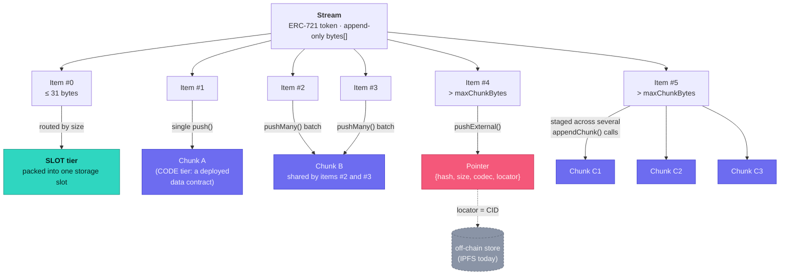
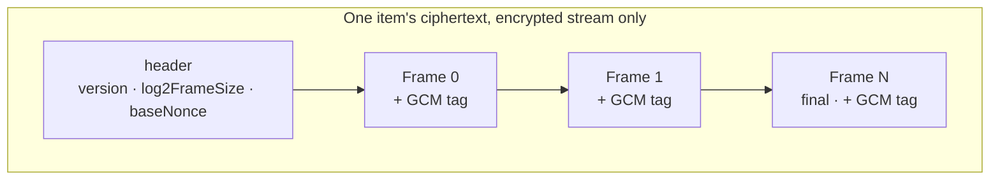

# Mnemonad Terms

Mnemonad is a storage layer on the Monad blockchain. Its core data structure, an unbounded on-chain `bytes[]` - is called a **Stream**.

This page explains other terms used throughout the Mnemonad documentation, UI, and codebase, so that both you and AI agents can use it as a quick reference and get a better understanding of how Mnemonad’s architecture fits together.

### Stream

A stream is an append-only `bytes[]`, exposed as an ERC-721 token. Whoever owns the token owns
the stream and decides who can write to it.

You might see streams called "vectors" in old commits, screenshots, and external links. That
was the earlier name. It is the same thing. For the code, see the `Stream` struct,
`streamIdFor`, and `getStreamInfo` in `Mnemonad.sol`.

A stream's id is known before the stream exists. `streamIdFor` computes it off-chain from
`(creator, salt)`. That is what lets you create an encrypted stream in a single transaction:
the data key can be wrapped for the id up front, with no need to ask the chain for it first.


A few words in this codebase mean something narrower than they sound. `Chunk` and `item` are
the tricky pair: they look interchangeable, and they are not. This page pins down what each
word means, so the same word never means two different things in two different layers.

## The core hierarchy

```
Stream                      ← one ERC-721 token; an append-only bytes[]
  └─ Item                   ← one thing you push (`push`/`pushMany`/`pushExternal`)
       ├─ on-chain: SLOT or CODE tier
       │    └─ Chunk        ← one deployed storage unit that holds an item's bytes
       └─ off-chain: EXTERNAL tier
            └─ Pointer      ← hash + locator on-chain, instead of the bytes
Frame                       ← independent of the above: one slice of encrypted ciphertext
```

### Visual overview

Two examples show why `chunk` and `item` are different. Item #5 is big, so it spans several
chunks. Items #2 and #3 are small, so one `pushMany` call packs them into a single chunk.



Framing lives on a different layer. On an encrypted stream, an item's ciphertext is cut into
frames, no matter which tier ends up holding it.




### Item

An item is one thing you push to a stream. `push`, `pushMany`, and `pushExternal` all create
items (see the `Item` struct and the `ItemCommitted` event). Each item has an index: `0`, `1`,
`2`, and so on. The index never changes once the item is committed. `truncateFrom` hides the
early indexes, but it does not renumber the ones that are left.

**An item's size is not the size of its storage.** Encrypt an 8-byte item and it takes 34
bytes on-chain (the Frame section explains why). Push it in a batch with `pushMany`, and its
bytes can share a chunk with other items. "How big is my item?" and "How much storage does it
use?" are two different questions. The Chunk section covers the second one.

### Chunk

A chunk is one deployed on-chain storage unit. In practice, it is a CODE-tier data contract
(see `DataChunk.sol`) that holds raw bytes as its own bytecode. A chunk can hold up to
`maxChunkBytes`. `MAX_CHUNK_BYTES_CEILING` is the highest that value can be, and each
deployment sets its own cap as a constructor parameter. You can read it with `getStreamInfo`
or `maxChunkBytes()`.

Items and chunks relate in both directions, and neither direction is 1:1:

- **One item can span several chunks.** If an item is bigger than `maxChunkBytes`, it is
  staged over several `appendChunk` calls. Each call adds one chunk. `getItemRefs` returns the
  full `chunks[]` list for that item.
- **Several items can share one chunk.** `pushMany` packs a batch into one deployed chunk when
  everything fits. The size of each item does not matter here. This is why an 8-byte item can
  end up in the CODE tier: batching decided it, not size. `Item.offset` tells you where an
  item starts inside the shared chunk.

This is also why "chunk" is not the public name for "the thing you push". The word already
means the storage unit. If it meant the logical unit too, "1 item, 5 chunks" and "5 items,
1 chunk" would both sound like nonsense.

### Tier / Store

The tier says where an item's bytes live. There are three, recorded in `Item.store` (the
`Mnemonad.Store` enum):

| Tier | Where | Size | Notes |
|---|---|---|---|
| `SLOT` | One storage slot | Up to 31 bytes | The cheapest choice for tiny items. At 32 bytes, a Solidity `bytes` value no longer fits in one slot. |
| `CODE` | A deployed data contract (a chunk) | 32 bytes up to `maxChunkBytes` | Deploying costs about 216 gas per byte. Storage costs 537. Past the crossover, CODE is cheaper, so the contract routes items here. |
| `EXTERNAL` | Off-chain (IPFS today) | Any size, even above `maxChunkBytes` | Only a `Pointer` (hash and locator) goes on-chain. See Pointer below. |

When you push exactly one item, `_appendOne` picks between SLOT and CODE by size alone. A
`pushMany` batch of 2 or more items works differently: it always packs into CODE if it fits,
however small each item is (see Chunk above).

### Pointer

A pointer is the on-chain record of an EXTERNAL item: `{hash, size, codec, locator}`.

- `hash` is the sha256 of the real off-chain payload. A reader uses it to check what a gateway
  sends back.
- `locator` is where the payload lives in its backend. Today that is an IPFS CID.
- `codec` says what format the locator uses. It lets the contract support Arweave, HTTPS, and
  others later, without a redeploy.

See `pointerAt` and `pushExternal`.

### Frame

A frame has nothing to do with a chunk, even though the names sound alike. It is a slice of an
item's ciphertext that you can decrypt on its own. Frames exist only on encrypted streams (see
`MnemonadCrypto.js`).

Each frame is `GCM(key, baseNonce||index, plaintext_slice, aad)`: its own encryption of one
piece of the plaintext. Its position is bound into the AAD, so nobody can reorder or truncate
frames without being noticed. Frames also make partial reads possible. You can read a range of
a huge encrypted item without decrypting all of it first.

Framing costs bytes: a 10-byte header, plus a 16-byte tag per frame. That is why an encrypted
item is always bigger on-chain than its plaintext. An 8-byte item becomes 10 + 8 + 16 = 34
bytes. That is over the 32-byte line between SLOT and CODE, so a tiny item goes to CODE just
because of framing. On an encrypted stream, only plaintexts of 5 bytes or less (5 + 26 = 31)
still land in SLOT.

Framing does not depend on how the data key is wrapped. Two key-encryption-key (KEK) methods
exist:

- **Signer-based:** tied to the owner, derived from a wallet signature.
- **Password-based:** derived with PBKDF2 and not tied to the owner. Anyone with the password
  can unwrap the key.

For the full comparison, see [`encryption/encryption.md`](encryption/encryption.md). For the
SDK calls that unlock each one, see the Encryption section of [`js/README.md`](js/README.md).

## Everything else

| Term | Meaning |
|---|---|
| **Registry** | The `Mnemonad` contract: the single ERC-721 collection that every stream belongs to. |
| **Gateway** | `MnemonadUploadGateway`, a separate contract that sells paid off-chain upload quota in MON, priced with Pyth's MON/USD feed. It is not part of the registry because of bytecode size (the comment at the top of its file explains). |
| **Escrow** | MON that a payer has committed on-chain through the gateway's `payForUpload`, for one specific `(contentHash, maxSize)`. It stays locked until a matching `pushExternal` settles it, or until the payer takes it back with `refund` after `requestTtl`. |
| **Sign server** | [`presign-server/`](presign-server/README.md). It reads a gateway escrow and hands back a one-shot Pinata upload URL, so the browser never holds a pinning credential. The explorer's debug panel calls it "Sign server (IPFS)". |
| **Locator** | Where an off-chain payload lives in its storage backend (an IPFS CID today). It is part of a `Pointer`. |
