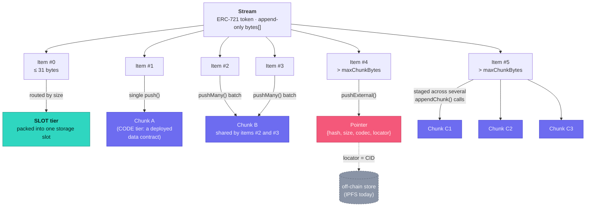
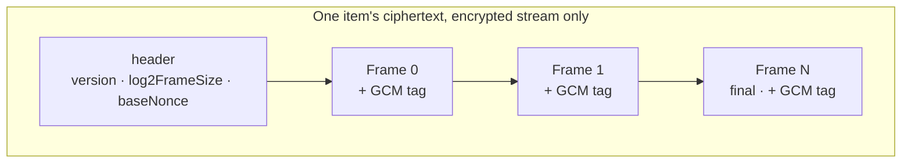

# Terms

Several words in this codebase mean something specific and *different* from what they might
suggest at a glance — and a couple of them (`chunk`, `item`) look interchangeable but aren't.
This is the canonical definition of each, so a term picked for one layer doesn't quietly
collide with a different meaning already in use at another.

## The core hierarchy

```
Stream                      ← one ERC-721 token; an append-only bytes[]
  └─ Item                   ← one thing you pushed (`push`/`pushMany`/`pushExternal`)
       ├─ on-chain: SLOT or CODE tier
       │    └─ Chunk        ← one deployed storage unit an item's bytes live in
       └─ off-chain: EXTERNAL tier
            └─ Pointer      ← hash + locator recorded on-chain instead of the bytes
Frame                       ← independent of the above: a slice of *encrypted* ciphertext
```

### Visual overview

The same hierarchy, with concrete examples of the two relationships that make `chunk` and
`item` genuinely different concepts — one item spanning several chunks (#5, staged across
multiple `appendChunk` calls) and several items sharing one chunk (#2 and #3, packed
together by one `pushMany` call):



Framing sits at a different layer entirely — it slices an item's *ciphertext*, on an
encrypted stream, regardless of which tier above ends up holding that ciphertext:



### Stream

One append-only `bytes[]`, exposed as an ERC-721 NFT — owning the token *is* owning (and
controlling write access to) the stream. Called "vector" until this session's rename; every
mention of "vector" anywhere older than that — old commits, screenshots, external
links — refers to the same thing. See `Mnemonad.sol`'s `Stream` struct, `streamIdFor`,
`getStreamInfo`.

A stream's id is deterministic — computed from `(creator, salt)` off-chain via `streamIdFor`,
before the stream exists — which is what lets an encrypted stream be created in one
transaction (the data key is wrapped scoped to an id that doesn't need a round trip to learn).

### Item

One thing pushed to a stream — the user-facing unit (`push`, `pushMany`, `pushExternal`; the
`Item` struct; the `ItemCommitted` event). An item is addressed by its index (`0`, `1`, `2`,
…) within its stream and never moves once committed — `truncateFrom` hides early indexes,
it never renumbers what's left.

**An item is not the same size as its storage.** Once encrypted, an 8-byte item costs 34
bytes on-chain — see the framing overhead under Frame, below. Once batched with siblings via
`pushMany`, an item's bytes might be packed into a chunk holding several other items too.
"How big is the item" and "how much on-chain storage does it occupy" are related but
different questions — see Chunk, below.

### Chunk

One deployed on-chain storage unit — specifically, one CODE-tier data contract (see
`DataChunk.sol`), holding raw bytes as its own bytecode. Capped at `maxChunkBytes`
(`MAX_CHUNK_BYTES_CEILING` at the ceiling; a specific deployment's actual cap is a constructor
param, read via `getStreamInfo`/`maxChunkBytes()`).

The item ↔ chunk relationship runs in *both* directions, and neither is 1:1:

- **One item can span several chunks.** An item bigger than `maxChunkBytes` is staged across
  multiple `appendChunk` calls, each depositing one more chunk; `getItemRefs` returns the
  full `chunks[]` array for such an item.
- **Several items can share one chunk.** `pushMany` packs a batch of items into a single
  deployed chunk when the total fits, entirely regardless of each item's own size — see the
  "why did my 8-byte item land as CODE tier" case: batching, not size, decided the tier.
  Each packed item's `Item.offset` is its byte position within the shared chunk.

This is exactly why "chunk" was rejected as the public-facing name for "one thing you push" —
see the earlier terminology discussion: the word is already load-bearing for the *storage*
unit, and reusing it for the *logical* unit would make "1 item, 5 chunks" and "5 items, 1
chunk" both read as nonsense.

### Tier / Store

Where an item's bytes actually live — one of three, tracked as `Item.store`
(`Mnemonad.Store` enum):

| Tier | Where | Size | Notes |
|---|---|---|---|
| `SLOT` | Packed into a single storage slot | ≤ 31 bytes | Cheapest for tiny items; a Solidity `bytes` value stops fitting in one slot at 32 bytes. |
| `CODE` | A deployed data contract (a chunk) | 32 bytes up to `maxChunkBytes` | ~216 gas/byte to deploy vs. 537 gas/byte for storage — cheaper than SLOT above the crossover, hence the routing. |
| `EXTERNAL` | Off-chain (IPFS today) | Anything, including bigger than `maxChunkBytes` | Only a `Pointer` (hash + locator) lives on-chain; see below. |

Routing between SLOT and CODE is by size alone, decided in `_appendOne` — but only when
pushing exactly one item. A batch of 2+ items via `pushMany` always packs into CODE if it
fits, regardless of how small each item is (see Chunk, above).

### Pointer

The on-chain record for an EXTERNAL item: `{hash, size, codec, locator}`. `hash` is the
sha256 of the actual off-chain payload, letting a reader verify what a gateway hands back;
`locator` is the address within that backend (an IPFS CID today; `codec` makes the format
extensible to Arweave/HTTPS/etc. without a redeploy). See `pointerAt`, `pushExternal`.

### Frame

Unrelated to Chunk despite the similar shape. A frame is one independently-decryptable slice
of an item's *ciphertext*, used only when a stream is encrypted (see `MnemonadCrypto.js`).
Each frame is `GCM(key, baseNonce||index, plaintext_slice, aad)` — its own nonce-derived
encryption of one piece of the plaintext, with the frame's position bound into the AAD so
frames can't be reordered or truncated silently. Framing is what makes a partial/ranged read
of a huge encrypted item possible without decrypting the whole thing first.

Framing overhead (10-byte header + 16-byte tag per frame) is why an encrypted item is always
larger on-chain than its plaintext size — an 8-byte plaintext item, for instance, costs
10 + 8 + 16 = 34 bytes of ciphertext, which crosses the 32-byte SLOT/CODE line above even
though the logical content is tiny. On an encrypted stream, only plaintexts of 5 bytes or
less (5 + 26 = 31) still land as SLOT; everything else routes to CODE purely from framing.

Framing is identical regardless of *how* the underlying data key got wrapped — two KEK
(key-encryption-key) methods exist: signer-based (owner-bound, derived from a wallet
signature) and password-based (PBKDF2-derived, not owner-bound — anyone with the password
can unwrap). See `js/README.md`'s Encryption section for the full comparison.

## Everything else

| Term | Meaning |
|---|---|
| **Registry** | The `Mnemonad` contract itself — the one ERC-721 collection every stream is a token in. |
| **Gateway** | `MnemonadUploadGateway` — the separate contract that sells paid off-chain upload quota in MON, priced via Pyth's MON/USD feed. Deliberately not part of the registry (bytecode size; see its own file comment). |
| **Escrow** | MON a payer has committed on-chain (via the gateway's `payForUpload`) against a specific `(contentHash, maxSize)`, held until settled by a matching `pushExternal` or reclaimed via `refund` after `requestTtl`. |
| **Sign server** | [`presign-server/`](../presign-server/) — reads a gateway escrow and hands back a one-shot Pinata upload URL, so the browser never holds a pinning credential. Labeled "Sign server (IPFS)" in the explorer's debug panel. |
| **Locator** | The address of an off-chain payload within its storage backend — an IPFS CID today. Part of a `Pointer`. |
